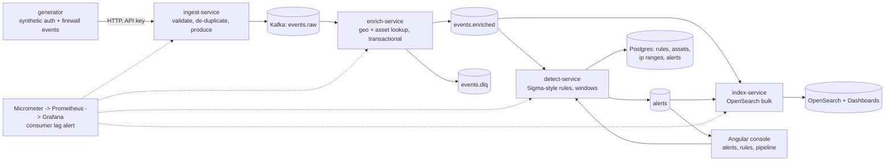

# threat-event-pipeline

A security event pipeline on the JVM, built the way a detection-engineering team would build it: synthetic
Windows authentication and firewall logs enter over HTTP, flow through Kafka, get enriched with network and
asset context, are scored against Sigma-shaped YAML rules with sliding-window thresholds, are indexed into
OpenSearch, and raise alerts that an Angular console shows. Every stage states and tests its delivery
guarantee, malformed input goes to a dead-letter topic, consumer lag is measured and alerted on, and the whole
thing runs on one machine with Docker Compose and ships as a Helm chart.

Java 21, Spring Boot 3.5, Spring Kafka, Apache Kafka 4.3 (KRaft), Postgres 16, OpenSearch 2.19, Angular 20,
Micrometer, Prometheus, Grafana, Testcontainers, Playwright, Helm. Everything in the repository is synthetic
or public; nothing needs an account.

## Architecture



| Module | Role | Delivery guarantee |
|---|---|---|
| `common` | `Event`, `EnrichedEvent`, `Alert` records with validation, topic names, shared JSON, the synthetic generator | |
| `ingest-service` | `POST /api/events` (batch of validated events), `X-API-Key`, per-key token bucket, produces to `events.raw` keyed by source address; `POST /api/generate` drives synthetic load | idempotent producer, `acks=all`; duplicate event ids dropped for ten minutes; 429 when the key's bucket is empty, 503 with `Retry-After` when the producer buffer is full |
| `enrich-service` | consumes `events.raw`, adds country, ASN and internal flag from `ip_ranges` (inet containment) and owner and criticality from `assets`, produces `events.enriched`; malformed input to `events.dlq` with the error in headers | consume-transform-produce in one Kafka transaction per poll; outputs and offsets commit together, downstream reads `read_committed`; a poison record is retried three times then dead-lettered on its own |
| `detect-service` | loads `rules/*.yml` into Postgres, evaluates stateless rules per event and threshold rules over tumbling windows per key, stores and produces `alerts`; REST for alerts, rules and stats | at-least-once with manual acknowledgement; alert ids are deterministic on (rule, key, window) and the store upserts, so redelivery is harmless |
| `index-service` | bulk-indexes `events.enriched` and `alerts` into daily OpenSearch indices | documents keyed by event or alert id; a failed bulk is redelivered with exponential back-off |
| `console` | Angular 20 (standalone, signals, zoneless): alerts with filters and detail, rules with hit counts, pipeline tab with the generator and Prometheus rates | |

The services share one Postgres but never write the same tables: enrich owns the lookup tables, detect owns
rules and alerts, each with its own Flyway history. [ADR 0001](docs/decisions/0001-four-services-on-kafka-with-a-shared-contract.md)
explains the split, [ADR 0003](docs/decisions/0003-delivery-guarantees-per-stage.md) the guarantees.

## Detection rules

Rules follow the Sigma shape (`logsource`, `detection: selection / condition`, `level`, `tags`) with a small
`threshold` extension for counting over a window, so a Sigma rule of the supported subset drops in unchanged.
Field modifiers: `contains`, `startswith`, `endswith`, `re`, `gt`, `gte`, `lt`, `lte`, `cidr`. Conditions:
`and`, `or`, `not`, parentheses, `1 of them`, `all of them`. The seven bundled rules were written for this
project; no third-party rule content is redistributed.

| Rule | Level | Fires when |
|---|---|---|
| `auth-brute-force` | HIGH | 10 or more failed logons for one user from one source address in 60 s |
| `auth-password-spray` | HIGH | failed logons for 15 or more distinct users from one source address in 120 s |
| `auth-lateral-movement` | HIGH | one user logs on with explicit credentials (4648) to 5 or more distinct hosts in 120 s |
| `fw-port-scan` | MEDIUM | 50 or more distinct destination ports denied for one external source in 60 s |
| `fw-large-outbound-transfer` | HIGH | one allowed connection from an internal host moves more than 100 MB to an external address |
| `auth-logon-from-hostile-range` | CRITICAL | a successful network logon whose source falls in a range tagged hostile in `ip_ranges` |
| `auth-special-privileges-non-admin` | CRITICAL | event 4672 on a critical asset for an account outside the service-account naming convention |

```yaml
id: auth-password-spray
title: Password spray from one source
level: HIGH
tags: [attack.credential_access, attack.t1110.003]
logsource: { product: windows, category: AUTH }
detection:
  selection:
    event_code: "4625"
  condition: selection
threshold:
  count: 15
  window: 120s
  groupBy: [src_ip]
  distinct: user
```

Add a rule by dropping a file into the directory mounted at `/rules` (`DETECT_RULES_DIR`) and calling
`POST /api/rules/reload`; the catalogue in Postgres and the console update. Alerts carry the rule, severity,
grouping key, window, event count, up to 50 contributing event ids, and the detection latency measured from
the moment ingest accepted the first contributing event.

## Results

All numbers below come from committed scripts run on one machine (Docker Desktop with WSL2 on Windows 11,
Intel i7 with 20 threads, 16 GB VM memory) with the full Compose stack including the observability profile.
They describe this pipeline on this machine, not a cluster.

### Load run

`load/run-load.sh` drives the generator at a target rate for 60 s per step with 2 % attack traffic, then reads
the pipeline's own Prometheus metrics (1-minute rates, the maximum lag over the step, detection latency
quantiles from the detect histogram) and waits for lag to drain before the next step. It writes
`load/results/latest.json`; `python load/render-results.py --write README.md` renders the table below from it.

<!-- LOAD-RESULTS -->
| Target events/s | Achieved at ingest | Enriched/s | Detected/s | Indexed/s | Max consumer lag | Detection p95 | Detection p99 | Alerts/s |
|---|---|---|---|---|---|---|---|---|
| 500 | 499 | 463 | 488 | 489 | 125 | 11 ms | 14 ms | 4.4 |
| 1,000 | 998 | 971 | 932 | 935 | 228 | 14 ms | 19 ms | 10.7 |
| 2,000 | 1,996 | 1,847 | 1,949 | 1,956 | 317 | 16 ms | 21 ms | 19.4 |
| 4,000 | 3,992 | 3,868 | 3,708 | 3,719 | 826 | 22 ms | 27 ms | 41.3 |
| 8,000 | 7,985 | 7,366 | 7,774 | 7,793 | 1,348 | 26 ms | 38 ms | 70.1 |
| 16,000 | 15,969 | 15,430 | 14,811 | 14,856 | 2,971 | 24 ms | 32 ms | 136.9 |

Run 2026-10-17 11:43 UTC, 60 s per step, attack share 2%, seed base 1792237002; single machine, Docker Desktop (WSL2) on Windows 11, Intel i7 / 20 threads, 16 GB VM memory. Rates are 1-minute Prometheus rates read at the end of each step, lag is the maximum over the step across all consumer groups, latency is ingest-accepted to alert-created from the detect histogram.
<!-- /LOAD-RESULTS -->

The generator runs inside ingest-service and calls the same accept path as `POST /api/events`, so the
numbers include validation, de-duplication and the producer but not HTTP parsing. At 16,000 events/s the stack
had not saturated: lag stayed under 3,000 records (under a fifth of a second of traffic) and detection p99 at
32 ms. A single 60 s probe at 32,000 (`load/results/latest-32k-probe.json`, run with `RATES=32000`) found the
knee: the generator produced 31,938/s and enrich and detect kept pace at about 31,400/s each, but the index
stage peaked at about 27,000 documents/s, consumer lag grew to 307,000 records and detection latency rose to
p95 4.1 s and p99 5.3 s. On this machine the first stage to give out is OpenSearch bulk indexing, not Kafka or
the services.

The first run of this script found the enrich stage saturating at about 65 events per second: ingest keyed
records by feed name, so one generator run landed on one partition, and the transactional producer committed
one transaction per record at about 15 ms each (`sendOffsetsToTransaction` plus commit, read from the
producer's own metrics). Keying by source address and spanning the transaction over the poll (up to 500
records) is what produced the table above; the change and the measurement are recorded in
[ADR 0003](docs/decisions/0003-delivery-guarantees-per-stage.md).

### Correctness

- `EnrichIT` sends 31 well-formed and 2 malformed records and asserts exactly 31 enriched records with the
  expected context (a hostile-range source resolves to its country and ASN, a `10.` source is internal, a
  known host gets its owner and criticality) and exactly 2 dead-lettered records with `error` and
  `error-stage` headers.
- `DetectIT` replays a password-spray burst twice and asserts one alert, because the alert id is
  deterministic and the store upserts.
- `IndexIT` sends every document twice and asserts the count does not double.
- `RuleEngineTest` covers the parser, the modifiers, the condition grammar, and the window arithmetic.
- The alert rules have promtool unit tests (`observability/alerts_test.yml`): eight scenarios, including the
  consumer-lag alert firing after two minutes above the threshold and staying quiet below it.

## Running it

```bash
cp .env.example .env
docker compose up -d --build                        # Kafka, Postgres, OpenSearch + Dashboards, 4 services, console
docker compose --profile observability up -d        # + kafka-exporter, Prometheus, Alertmanager, Grafana
```

| What | Where |
|---|---|
| Console | http://localhost:4200 |
| Ingest API, Swagger | http://localhost:8081/swagger-ui.html |
| Detect API, Swagger | http://localhost:8083/swagger-ui.html |
| OpenSearch Dashboards | http://localhost:5601 (indices `events-*`, `alerts-*`) |
| Prometheus, Alertmanager, Grafana | http://localhost:9093, :9096, :3004 |

Generate traffic from the console's Pipeline tab or directly:

```bash
curl -X POST http://localhost:8081/api/generate -H 'Content-Type: application/json' \
  -d '{"eventsPerSecond":500,"seconds":60,"attackShare":0.05}'
```

The first start takes two to three minutes while Kafka and OpenSearch warm up. Plan on 6 GB of memory for the
full stack. `docs/DEPLOY.md` has the load run, the test commands, the Helm install and the teardown.

### API

| Method and path | Service | Does |
|---|---|---|
| `POST /api/events` | ingest | accepts a JSON array of events (up to `maxBatch`), returns `202 {accepted, duplicates}`; `400` on validation errors, `401` without a valid `X-API-Key` when keys are configured, `429` over the per-key rate, `503` + `Retry-After` when Kafka cannot keep up |
| `POST /api/generate`, `GET /api/generate` | ingest | start a synthetic run (`eventsPerSecond`, `seconds`, `attackShare`, `seed`) and read its progress; `409` while one is running |
| `GET /api/alerts?severity=&ruleId=&minutes=&limit=&offset=` | detect | alerts, newest first |
| `GET /api/alerts/{id}` | detect | one alert with its contributing event ids |
| `GET /api/rules`, `GET /api/rules/{id}/yaml` | detect | the catalogue with hit counts, and a rule's source |
| `POST /api/rules/reload` | detect | reload the rules directory |
| `GET /api/stats?minutes=` | detect | alerts per rule and severity over a window |
| `GET /actuator/health/{liveness,readiness}`, `GET /actuator/prometheus` | all | probes and metrics |

Every service logs JSON lines (logstash encoder) with the service name and trace and span ids when present; each
alert is logged with its rule, severity, key, event count and latency.

## Observability

- Micrometer counters and timers per stage: `ingest_events_total{outcome}`, `enrich_events_total{outcome}`,
  `enrich_batch_size`, `detect_events_total`, `detect_alerts_total{rule,severity}`,
  `detect_latency_seconds` (ingest to alert, histogram), `index_documents_total{kind}`, plus the Kafka client
  metrics and JVM metrics Spring Boot exposes.
- `kafka-exporter` publishes `kafka_consumergroup_lag` per group and partition; Grafana's dashboard
  (`observability/grafana/dashboards/threat-pipeline.json`) shows events per second by stage, lag by group,
  detection latency p50/p95/p99, alerts per minute by rule, dead letters, ingest rejections, JVM heap, and
  produce and bulk latency.
- Seven Prometheus alert rules with promtool tests: `ConsumerLagHigh`, `ConsumerStalled`, `DeadLetterRate`,
  `IngestRejections`, `DetectionLatencyHigh`, `IndexFailures`, `ServiceDown`. Run `make alerts-test`.

## Tests and CI

| Suite | Count | Runs where |
|---|---|---|
| JUnit unit tests (`common`, `ingest`, `detect` rule engine) | 16 | `mvn verify`, surefire |
| JUnit integration tests with Testcontainers (Kafka, Postgres, OpenSearch) | 7 | `mvn verify`, failsafe |
| Angular unit tests (Karma, headless Chromium) | 3 | `npx ng test` |
| Playwright end to end against the Compose stack | 1 | `npx playwright test` |
| promtool alert-rule tests | 8 scenarios | `make alerts-test` |
| Helm | lint and template (15 objects) | `make helm-lint` |

GitHub Actions (`.github/workflows/ci.yml`) runs seven jobs on every push and pull request: `java` (Spotless
check, `mvn verify` with JaCoCo), `console` (lint, unit tests, production build), `e2e` (Compose stack,
Playwright, a short load run), `alerts` (promtool), `helm` (lint and template), `gitleaks`, and `images`
(builds all five images). Dependabot watches Maven, npm, Docker and Actions weekly.

## Security

- `X-API-Key` on the ingest API with a token bucket per key (bucket4j); an empty key list is allowed only for
  local development and the `.env.example` says so.
- Every inbound field is validated by size, pattern and range before it is produced; detect and index never
  trust a record's shape either.
- No secrets in the repository: `.env` is ignored, passwords and keys come from the environment or, on
  Kubernetes, from Secrets referenced by the chart; `gitleaks` runs in CI.
- Images run as a non-root user on `eclipse-temurin:21-jre-alpine`; pods run with a read-only root filesystem,
  dropped capabilities, a NetworkPolicy and a PodDisruptionBudget for detect.
- Dependencies are pinned in `pom.xml` and `package-lock.json` and updated by Dependabot.

## Kubernetes

`deploy/helm/threat-event-pipeline` deploys the four services and the console with readiness and liveness
probes, rolling updates with zero unavailable, resource requests and limits, an optional Ingress and an
optional ServiceMonitor; Kafka, Postgres and OpenSearch are external and configured in `values.yaml`. The chart
lints and renders 15 objects in CI. `docs/DEPLOY.md` has the install commands.

## Limitations

- Single machine. The load run shares one host with the broker, the database, OpenSearch, Prometheus and the
  generator itself, so it reports where this stack saturates here, not the services' ceilings.
- Threshold windows live in each detect instance's memory (Caffeine, bounded by `max-windows`). One instance
  with three consumer threads sees every key; two instances would each see the partitions they own, so a rule
  grouping by a field other than the partition key (source address) would under-count across instances. A
  state store (Kafka Streams or Flink) is the next step.
- Ingest de-duplication is per instance and in memory; two replicas could each accept the same event id.
- Lookups are synthetic: `ip_ranges` and `assets` are small tables seeded by Flyway, not a GeoIP database or a
  CMDB.
- No distributed traces. Metrics and structured logs carry the ids; adding OpenTelemetry to the Spring Kafka
  listeners is straightforward and was left out to keep the images small.
- OpenSearch retention is by daily index; nothing deletes old indices (no ISM policy).

## Decisions

- [0001 Four small services on Kafka topics, one shared contract module, no shared database writes](docs/decisions/0001-four-services-on-kafka-with-a-shared-contract.md)
- [0002 Rules follow the Sigma shape, with a small threshold extension and no Sigma backend](docs/decisions/0002-sigma-shaped-rules-with-a-threshold-extension.md)
- [0003 Delivery guarantees per stage: transactional enrich, idempotent detect and index, DLQ for poison](docs/decisions/0003-delivery-guarantees-per-stage.md)
- [0004 Micrometer counters per stage, kafka-exporter for lag, and alerts that are unit tested](docs/decisions/0004-observability-and-the-lag-alert.md)
- [0005 Synthetic traffic with injected attack scenarios, and numbers labelled single-machine](docs/decisions/0005-synthetic-traffic-and-single-machine-numbers.md)

## Layout

```
common/            records, topics, JSON, synthetic generator
ingest-service/    HTTP ingest, API keys, rate limit, generator
enrich-service/    transactional enrichment, Flyway lookup tables
detect-service/    rule loader, matcher, condition parser, window engine, alerts API, bundled rules
index-service/     OpenSearch templates and bulk indexing
console/           Angular console, Playwright e2e, nginx image
observability/     Prometheus, alert rules and tests, Alertmanager, Grafana provisioning and dashboard
load/              load script and results
deploy/helm/       Helm chart
docs/              PLAN.md, DEPLOY.md, decisions/
```

## License

MIT.
