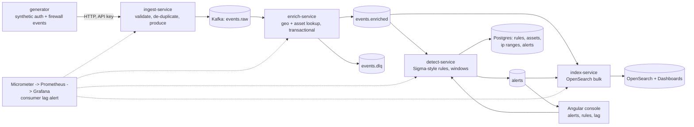

# Plan: threat event pipeline

Goal: a security-event pipeline the way a detection-engineering team would build it on the JVM: synthetic
auth and firewall logs flow through Kafka, get enriched (geo and asset context), are scored against
Sigma-style YAML rules, indexed in OpenSearch, and raise alerts that an Angular console shows. Every stage
is idempotent, malformed input goes to a dead-letter topic, consumer lag is monitored and alerted, and the
whole thing runs on one machine with Docker Compose and ships as a Helm chart.

Targets ReliaQuest (Java, Kafka, detection, Elasticsearch/OpenSearch), Citi and JPMorgan Java teams,
Galatea (Java 21, Kubernetes), Tampa General (Angular).

## Architecture

## Services (Java 21, Spring Boot 3.5, Maven multi-module)

| Module | Role | Guarantees |
|---|---|---|
| `common` | event and alert records, JSON config, Kafka topic names, metrics names | |
| `ingest-service` | `POST /api/events` (single or batch, validated), API key, rate limit, produces to `events.raw` keyed by source; `/generate` for synthetic load | idempotent producer; duplicate event ids dropped (Caffeine window) |
| `enrich-service` | consumes `events.raw`, adds country/ASN from an `ip_ranges` table and owner/criticality from `assets`, produces `events.enriched`; malformed to `events.dlq` | consume-transform-produce in one Kafka transaction per poll (`read_committed`); offsets committed in the transaction |
| `detect-service` | loads `rules/*.yml` (Sigma-style selection/condition) into Postgres, evaluates stateless rules per event and threshold rules over tumbling windows per key; produces `alerts`; REST `GET /api/alerts`, `GET /api/rules`, `POST /api/rules/reload` | at-least-once with idempotent alert upsert on (rule, key, window) |
| `index-service` | bulk-indexes `events.enriched` and `alerts` into OpenSearch with per-day indices and ILM-like retention | idempotent by document id |
| `console` | Angular: alerts table with filters and detail, rules list with hit counts, pipeline health (lag, rates) | |

Backpressure: bounded consumer `max.poll.records`, producer buffer and `linger.ms`, ingest returns 429
from the rate limiter and 503 when the producer buffer is exhausted. Consumer lag: Micrometer's Kafka
consumer metrics plus `kafka-exporter`; alert on lag above a threshold for 2 minutes.

## Numbers to produce (single machine, Docker Desktop on Windows, i7 / 20 threads)

- Sustained events per second end to end (generator -> alert index) with the lag staying bounded.
- Detection latency p95: event timestamp at ingest to alert creation, recorded on every alert.
- Consumer lag under load, from the same Prometheus the alert reads.

## Milestones

| # | Milestone | Done when |
|---|---|---|
| 1 | common + ingest-service with validation, API key, rate limit, generator; unit tests | `POST /api/events` lands on `events.raw` (Testcontainers Kafka) |
| 2 | enrich-service transactional consume-produce with DLQ; Postgres lookups | integration test: good event enriched, bad event in DLQ, exactly one output per input |
| 3 | detect-service: YAML rules, stateless + threshold rules, alerts API | rule tests; integration test raises an alert from 5 failed logins |
| 4 | index-service + OpenSearch; Dashboards saved search | integration test: documents visible by id |
| 5 | Angular console + Playwright | e2e passes against compose |
| 6 | Observability: JSON logs, Prometheus, Grafana dashboard, 6 alerts with promtool tests, lag alert fires in a test | |
| 7 | Load run: generator at increasing rates; events/s, p95 detection latency, lag | numbers in README with the method |
| 8 | Helm chart (lint + template in CI), CI (Maven, Angular, Testcontainers, e2e, promtool, helm, gitleaks, images), Dependabot | |
| 9 | README, ADRs 0001-0005 | |

## Data

Synthetic only: a generator produces Windows-style authentication events (event ids 4624/4625/4648/4672,
users, hosts, source IPs from private and public ranges) and firewall events (allow/deny, ports, bytes)
with a configurable share of attack scenarios (password spray, brute force, lateral movement, port scan,
data exfiltration) so detections have something to find. Geo and asset lookup tables are also synthetic.
Rules follow the Sigma shape (`detection: selection / condition`) so real Sigma rules of the supported
subset can be dropped in. The seven bundled rules are written for this project; no third-party rule
content is redistributed.

## Status (2026-10-17)

| # | Milestone | Status |
|---|---|---|
| 1 | ingest-service | done: 4 unit tests, 4 integration tests (Kafka in Testcontainers) |
| 2 | enrich-service | done: transactional consume-produce, DLQ, lookups; integration test asserts exactly one output per input |
| 3 | detect-service | done: 7 rules, parser/matcher/engine tests (8), integration test with a replayed burst |
| 4 | index-service | done: templates, bulk, idempotent ids; integration test against OpenSearch |
| 5 | Angular console + Playwright | done: lint, 3 unit tests, production build, e2e against compose |
| 6 | Observability | done: 7 alert rules with 8 promtool tests, Grafana dashboard, kafka-exporter lag |
| 7 | Load run | done: numbers and method in the README |
| 8 | Helm chart, CI, Dependabot | done: chart lints and renders 15 objects; CI runs Maven verify with Testcontainers, console checks, compose e2e, promtool, helm, gitleaks, images |
| 9 | README, ADRs | done, 5 ADRs |

## Cost

Zero. Everything runs locally; the Helm chart targets any Kubernetes (P9 will host it on k3s).
